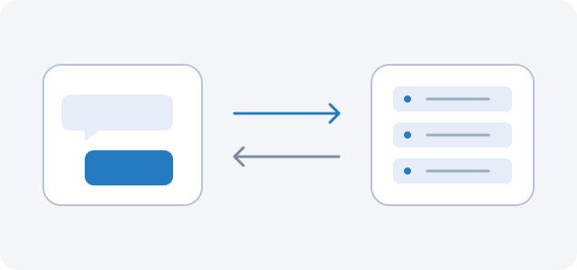

# Oxrail Browser Control

Eleven tools over MCP stdio, forwarded to the Oxrail MCP server. It opens its own
headless Chrome with a dedicated profile, reads a page inside a character budget,
and clicks by the number the read printed.

## The budget is the point

A page with 65 000 DOM nodes returns 112 characters rather than 65 022. The read
filters what the question touches, folds a run of near-identical controls onto one
line, and stops at a ceiling. Nothing in the read clicks, types, or navigates.

Controls are printed one per line as `[12] button "Sign in"`, and a run becomes
`[0]-[39] button "Item 0" .. "Item 39" (40 controls, one line)` — every number in
that range still works.

## Tools

| Tool            | Does                                                                   |
| --------------- | ---------------------------------------------------------------------- |
| `browser_open`  | Starts Chrome on a URL. `headless` defaults to true.                   |
| `browser_view`  | Reads the page; `mode` narrows to `links` or `forms`.                  |
| `browser_read`  | Reads only what is needed: `article`, `map`, `query`, or `changed`.    |
| `browser_click` | Clicks a control by `ref` or by its `text`.                            |
| `browser_type`  | Types into the focused field, optionally submitting.                   |
| `browser_key`   | Presses a key.                                                         |
| `browser_nav`   | Opens, goes back, goes forward, or reloads.                            |
| `browser_shot`  | Saves a screenshot and returns its path.                               |
| `browser_state` | Reports whether Chrome runs, on which profile, and how soon it closes. |
| `browser_login` | Saves and switches sign-ins per site and profile.                      |
| `browser_close` | Closes the browser.                                                    |

## Settings

`OXRAIL_BROWSER_HEADLESS` — `0` shows the window; anything else stays headless.

`OXRAIL_BROWSER_IDLE_MS` — idle time before Chrome closes, 60 000 to 900 000.

## Requirements

The server entry point is the built artifact `dist/browser-control/mcp.mjs` from the
Oxrail checkout, which the patch names by absolute path. Run `pnpm build` there if
the file is missing; the MCP server does not start without it.
